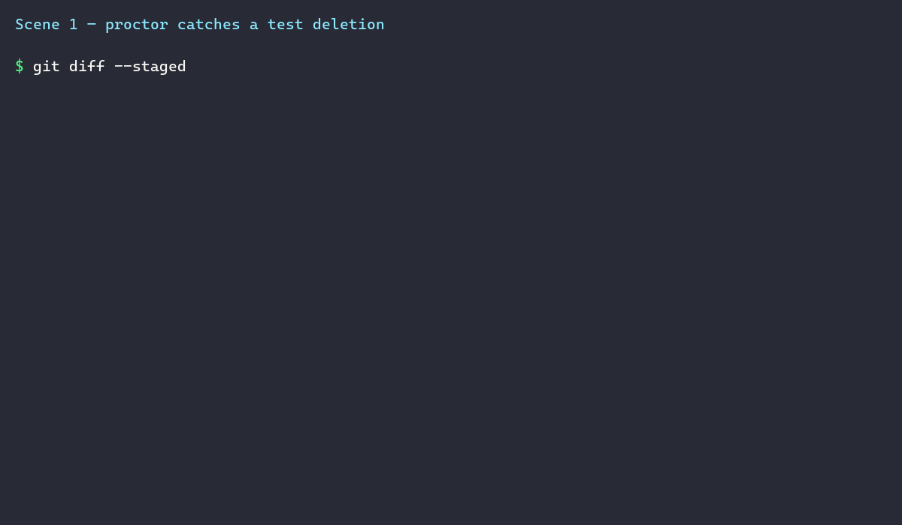

<p align="center">
  
</p>

<h1 align="center">proctor</h1>

<p align="center">
  <a href="https://www.npmjs.com/package/@kavishdua/proctor"></a>
  <a href="https://github.com/catfish-1234/proctor/actions/workflows/ci.yml"></a>
  <a href="https://github.com/catfish-1234/proctor/blob/main/LICENSE"></a>
</p>

<p align="center"><strong>Catch test tampering in AI coding agents' changes.</strong></p>

proctor checks your git diff for deleted tests, weakened assertions, hardcoded answers,
swallowed errors, and disabled checks. Its hooks block changes that trigger an error finding.

The default check runs offline: no account or API key. The optional `--ai` judge sends candidates
to Anthropic and needs `ANTHROPIC_API_KEY`. You need Node 20 or newer; building and testing from
source needs Node 20.19+ or 22.12+.

## Contents

**Getting started**

- [Quickstart](#quickstart), try it from source against a repo
- [Install](#install), and exactly what it writes
- [What that setup does](#what-that-setup-does)
- [One thing to do afterwards](#one-thing-to-do-afterwards)
- [Checking it worked](#checking-it-worked)
- [Removing it](#removing-it)

**Using it day to day**

- [See it catch a real cheat](#see-it-catch-a-real-cheat)
- [What happens when it blocks](#what-happens-when-it-blocks)
- [What do the codes mean?](#what-do-the-codes-mean)
- [Badges](#badges)
- [CI](#ci)
- [Dynamic checks](#dynamic-checks), opt-in runtime evidence

**Why it works**

- [How it works](#how-it-works)
- [Can the agent get around it?](#can-the-agent-get-around-it)
- [What proctor is for](#what-proctor-is-for), scope and limits
- [By the numbers](#by-the-numbers), with the full history in [docs/BENCHMARKS.md](docs/BENCHMARKS.md)

**Reference**

- [Going further](#going-further), every doc page
- [The Proctor](#the-proctor)
- [License](#license)

## Quickstart

Check the changes in any git repository, with nothing to install first:

```bash
cd /path/to/repository
npx @kavishdua/proctor check
```

To run it from source instead:

```bash
git clone https://github.com/catfish-1234/proctor.git
cd proctor
npm ci
npm run build
node dist/cli.js check /path/to/repository
```

The `✓ proctor: honest pass` line means there are no error-level or approved findings. Warnings
may still be reported. Checks cover source and configuration changes as well as tests.

The check writes nothing to the repository being checked and makes no runtime network call.
`npm ci` installs dependencies in the proctor checkout.

## Install

Agent plugins install the ruleset. The Gemini CLI extension also bundles an AfterAgent hook
(experimental, opt-in: contract-verified only, and consumer Gemini CLI auth is retired by Google;
Antigravity CLI is the supported successor).
For CLI checks and project hooks, use the local npm installation below. `proctor setup` adds
turn-end enforcement for Claude Code and Codex CLI, and for Gemini CLI when you opt in with
`proctor setup --agents gemini-cli` (experimental). The Cursor plugin also includes
a stop hook.

**Claude Code**

```
/plugin marketplace add catfish-1234/proctor
/plugin install proctor@proctor-marketplace
```

**Gemini CLI or Qwen Code** (experimental: contract-verified only, never exercised against a live
Gemini CLI session; consumer Gemini CLI auth is retired by Google, and Antigravity CLI is the
supported successor)

```bash
gemini extensions install https://github.com/catfish-1234/proctor
qwen extensions install https://github.com/catfish-1234/proctor
```

The Gemini CLI extension loads its AfterAgent hook from `hooks/hooks.json` and runs the bundled
CLI, so no separate npm installation or `proctor setup` is needed for that hook. The manifest
keeps `contextFileName: "PROCTOR.md"`. This follows the
[Gemini extension hook layout](https://geminicli.com/docs/extensions/reference/#hooks).

**Other agents, or CLI use without an agent** (30 agents supported)

Add it to the repository as a dev dependency:

```bash
npm install --save-dev @kavishdua/proctor
```

**Proctor does not install guards during npm installation by default.** npm still updates your
package files and `node_modules`. Proctor prints what setup would write, then stops. From the
repository you want to guard, run:

```bash
npx proctor setup
```

### What that setup does

This is what `proctor setup` writes. It makes no network call. Git chooses the hook directory,
which may be outside the working tree when you use worktrees or `core.hooksPath`.

| Path | What it is | If it already exists |
| --- | --- | --- |
| The ruleset file for each agent this repo uses, e.g. `.claude/skills/proctor/SKILL.md`, `.cursor/rules/proctor.mdc`, `AGENTS.md` | The honest-completion rules your agent reads before it works | A shared file like `AGENTS.md` keeps your content; only proctor's delimited block is replaced |
| Git's hook directory (`.git/hooks/pre-commit` normally), or `.husky/pre-commit` when Husky is a dev dependency | Blocks a cheat at commit time; the Husky file is also staged | A foreign hook is backed up to `pre-commit.bak`, then replaced; merge it manually if needed |
| `.claude/settings.json` | The Claude Code Stop hook, written only if this repo uses Claude Code | Merged into the existing JSON; nothing else in the file changes |
| `.codex/hooks.json` | The Codex CLI Stop hook, written only if Codex is a selected or detected agent | Merged into the existing JSON, preserving other hooks and top-level fields |
| `.gemini/settings.json` | The Gemini CLI AfterAgent hook (experimental), written only when Gemini CLI is explicitly selected (`--agents gemini-cli` or `--all`), never on detection alone | Merged into the existing JSON, preserving other hooks and settings |
| `.proctor-adapter-manifest.json` | Records what was written, so `uninstall` can take exactly that back out | Rewritten |

proctor detects agents from their config files, such as `.cursor/`, `.claude/`, `.codex/`, `.gemini/`, or `WARP.md`,
and installs the ruleset for those agents. If it finds none, it writes `AGENTS.md`.
Run `proctor agents` to check the list before installing. Use `--all` for all 30 supported agents,
or `--agents claude-code,cursor` to choose them yourself.

The npm postinstall notice and automatic setup stay quiet in CI, global installs, transitive
installs, outside a git repository, and under `npx`. An explicit `proctor setup` still runs.

Set `PROCTOR_AUTO_SETUP=1` to run `proctor setup` automatically during installation.
Set `PROCTOR_NO_POSTINSTALL=1` to silence the install-time notice.

### One thing to do afterwards

**Commit what it wrote.** The ruleset files and `.proctor-adapter-manifest.json` are ordinary files
in your repo, and they only reach your teammates and your CI once they're committed.

```bash
git add -A && git commit -m "chore: add proctor"
```

If you use Claude Code, restart it so it picks up the new Stop hook.

If you use **Codex CLI**, two trust steps are required before the hook runs:

1. Trust the project at Codex's interactive prompt, or set `trust_level = "trusted"` under
   `[projects."/absolute/path/to/repo"]` in `~/.codex/config.toml`. Project hooks are silently
   ignored in untrusted projects.
2. Review and approve the new or changed hook when Codex prompts, or via `/hooks` in the CLI.

The Codex hook runs `proctor stop-hook --format codex`, which emits a JSON block decision with
finding feedback and exits `0`. It stays silent on clean checks and a follow-up
Stop with `stop_hook_active: true`, preventing a loop. Internal failures allow the turn with
bounded UNVERIFIED stderr diagnostics and no stdout (exit `1`, a nonblocking hook failure).

Verified end-to-end against codex-cli 0.164.0 on November 8, 2026: in `codex exec`, a change that
deleted a failing test was blocked at Stop with an RH001 finding, and Codex continued and acted on
the block reason; an honest fix completed with no block. Hook trust is one-time: Codex asks to
review new or changed hooks (the interactive prompt or `/hooks`), records trust against the hook
definition, and after that the hook runs in both interactive sessions and `codex exec`. The
`--dangerously-bypass-hook-trust` flag exists for one-off automation that vets hook sources outside
Codex; it is not part of standard setup. Contract source:
[Codex hooks](https://learn.chatgpt.com/docs/hooks.md).

If you use **Gemini CLI** (experimental, opt-in), hooks are enabled by default since v0.26.0. Gemini fingerprints project
hooks and warns before running new or changed ones. Review the one-time trust prompt and manage
hooks in the `/hooks` panel.

Gemini's AfterAgent fires once per turn after the final response. It runs
`proctor stop-hook --format gemini`, which checks the same uncommitted diff as the Codex hook.
A blocking finding emits only `{"decision":"deny","reason":"<finding output>"}` and exits `0`;
Gemini sends the reason to the agent as a new prompt requesting correction. Clean checks,
`stop_hook_active: true` and malformed input silently allow the turn. Internal failures allow the
turn with bounded UNVERIFIED diagnostics on stderr and no stdout (exit `1`, a nonblocking warning).
Ordinary blocks request a retry; they do not set `continue: false` to end the session.

Verified locally with documented AfterAgent payloads: a deleted test returns deny feedback with
RH001, a clean working tree is silent, and loop-guard/malformed-input skips silently allow.
Internal-error cases allow with UNVERIFIED diagnostics, not a block or clean claim. Tests also cover settings merge/uninstall round-trips and execution of the bundled
extension command without a separate npm install. This verifies the hook contract and local
integration; live Gemini CLI sessions were not exercised. Contract source:
[Gemini hooks reference](https://geminicli.com/docs/hooks/reference/#afteragent).

**Antigravity CLI (`agy`)** ships a Stop-hook plugin in `antigravity-plugin/`. Read the limits
first, because this hook is local feedback, not a gate:

- **The independent check is CI.** `proctor check --base <ref>` on the pushed diff (see the GitHub
  Action) is the only check that does not run inside the agent's session. It is independent only
  if the workflow, proctor config and required-check settings are controlled outside the agent's
  write and admin scope (for example branch protection that the agent's token cannot change).
  proctor does not set up branch protection or change account permissions.
- **The Stop hook is bounded feedback.** A block is a message to the agent. The agent can read it,
  keep the change anyway, or inspect the hook (a live trial did all of that). Antigravity has no
  `stop_hook_active` flag, so proctor re-checks on every Stop and re-blocks while the finding
  remains, up to a budget of 5 consecutive blocks per conversation
  (`PROCTOR_STOP_HOOK_BLOCK_BUDGET`, 1-50), so a stuck agent cannot burn unlimited model quota.
- **After the budget the finding is recorded as unresolved**, not forgotten. proctor writes
  `proctor/unresolved.json` inside the worktree's git directory (never into the working tree, so
  it cannot be committed), with the original finding, a baseline commit and timestamps, and no
  transcript content. `proctor unresolved` shows it and exits 2. The pre-commit hook runs
  `proctor unresolved --gate`, which blocks commits until a fresh complete check (working tree
  against HEAD plus every commit since the baseline) passes. Only that check clears it; a
  `--staged` or `--uncommitted` check alone never does, and an error or a missing baseline is
  reported as "unverified", not as clean. Credential-looking literals (tokens, keys, `password=`
  values) are redacted from stored findings on a best-effort basis, and the harness-supplied
  conversation id is sanitized and never used as a path. The record is a file anyone with access to the git
  directory can delete, and `git commit --no-verify` skips the hook, so this is not tamper-proof.
- `PROCTOR_STOP_HOOK_MODE=advisory` is an explicit opt-in that allows the Stop after the budget
  without recording anything. The default is `enforce`.
- proctor's checks are static diff checks. This hook does not catch cheating those checks cannot
  see.
- Verified live on Antigravity CLI 1.5.3 only: a deleted test was blocked and the reason reached
  the model; the agent did not restore it within four minutes and instead inspected the hook.
  Other versions, the desktop app and IDE, and tamper-resistance were not tested. The Antigravity
  docs disagree on the Stop response (`block` on the plugin page, `continue` on the hooks page);
  `block` is what 1.5.3 honors.

Install from a checkout of this repository (Antigravity installs plugins from a local
directory), with proctor on your `PATH` (`npm install -g @kavishdua/proctor`):

```bash
agy plugin validate --strict ./antigravity-plugin
agy plugin install ./antigravity-plugin
```

The plugin's `Stop` hook runs `proctor stop-hook --format antigravity` and returns
`{"decision":"block","reason":"<finding output>"}` when the uncommitted diff games the tests.
`proctor setup` does not edit Antigravity settings; `agy plugin uninstall proctor` removes the
plugin. Install the git hook with `proctor install-hook` to get the unresolved-findings gate.
A pre-commit hook installed by an older proctor version does not have the gate: rerun
`proctor install-hook` (a hook from another tool is backed up to `pre-commit.bak`, never silently
overwritten, and you merge it by hand). `proctor unresolved` tells you whether the gate is installed.

The hooks run checks automatically. A config file is optional.

### Checking it worked

```bash
npx proctor drift-check   # exits 0 if every deployed ruleset copy still matches the source
npx proctor statusline    # "proctor: watching", or "proctor: 3 caught" once it has blocked something
```

Or trip it deliberately: delete a test in a scratch branch and run `proctor check`.

### Removing it

```bash
proctor uninstall --dry-run   # see what would go
proctor uninstall
```

It removes only what it installed. Your own content in a shared file like `AGENTS.md` stays, a
pre-commit hook that isn't proctor's is left alone, and `proctor.config.json` is left for you to
keep or delete. Only proctor's Gemini AfterAgent command is removed from project settings;
unrelated hooks remain. To remove the separately installed Gemini extension and its bundled hook,
run `gemini extensions uninstall proctor`. To skip the git hook once without uninstalling:
`git commit --no-verify`.

## See it catch a real cheat

An agent deleted the test and told you it passed. It had been asked to make `slugify()` return
`''` for whitespace-only input; instead, it removed that test:

```diff
 describe('slugify', () => {
   it('converts spaces to dashes', () => {
     expect(slugify('Hello World')).toBe('hello-world');
   });
-  it('handles a whitespace-only input', () => {
-    expect(slugify('   ')).toBe('');
-  });
 });
```

```
$ proctor check
tests/slug.test.ts
  ❌ tests/slug.test.ts:5  [RH001]  Test function 'handles a whitespace-only input' was deleted in this change.
      Restore the deleted test or document why it was intentionally removed.

How to fix these honestly:
  proctor check --explain RH001 --fix

1 finding (1 error, 0 warnings)
$ echo $?
2
```

With the pre-commit hook installed, this finding blocks the commit until the test is restored
or the change is approved.

The recording shows the CLI detecting a deleted test, followed by the Claude Code Stop hook
blocking the same change during an agent session.



## What happens when it blocks

When a check fires, proctor prints the finding and suggested fix. Error findings exit `2` and
block the commit or agent turn. Review the suggestion, then fix the change or record an exception.

**The test change was intended.** For example, you removed a feature and its tests.
Record the reason to make the finding non-blocking:

```bash
proctor approve RH001 tests/legacy-billing.test.ts --reason "billing v1 removed in RFC-88"
git add proctor.config.json && git commit -m "chore: approve RH001 for legacy billing"
```

It stays visible in every report with your reason attached. Approvals are read from the **committed**
config, so an agent cannot approve its own change in the change it is making, and an approval you
haven't committed yet has no effect.

**It's a false positive.** Suppress that one line:

```js
// proctor-ignore: RH004 reason: this is a lookup table, not a fixture hardcode
```

The marker has to be committed before the change it excuses, for the same reason approvals do. See
[inline suppression](https://github.com/catfish-1234/proctor/blob/main/docs/CONFIGURATION.md#inline-suppression).

**You want to know why a check exists.** Every finding prints its ID, and every ID explains itself:

```bash
proctor check --explain RH001        # what this check looks for
proctor check --explain RH001 --fix  # what an honest fix looks like
```

## What do the codes mean?

For `proctor check`, exit `0` means no warning or error findings, `1` means warnings only, `2` means
error findings, and `3` means the check could not complete (for example, outside a git repository).
With `--ci`, warnings still appear in JSON, SARIF, and Markdown but exit `0`; text output shows
only errors. Invalid arguments can also exit `1` or `2`, and `--ai` without its key exits `1`.

Use `npx proctor check --staged` for the index or `npx proctor check --base origin/main` for
committed changes since the merge base. The default includes staged, unstaged, and untracked files.
Run `npx proctor check --help` for flags, or see the
[CLI reference](https://github.com/catfish-1234/proctor/blob/main/docs/CLI.md).

Every finding has a stable ID such as `RH001`, used in config, approvals, and reports. Use
`proctor check --explain <id>` for the description and fix guidance. The checks fall into two
families.

**RH0xx checks "the tests pass."** These read the test suite and the code directly beneath it.

| | Catches |
|---|---|
| RH001 | A test deleted or renamed away |
| RH002 | An assertion weakened into a vaguer one |
| RH003 | A test skipped, disabled, or commented out |
| RH004 | An implementation hardcoded to match a fixture |
| RH005 | A function body replaced with a stub |
| RH006 | A snapshot rewritten with no reason given |
| RH007 | A test excluded via a config change |
| RH008 | An assertion that always passes |
| RH009 | A trivial test swapped in for a real one |
| RH010 | An async test detached, or timeouts/retries used to mask a failure |
| RH011 | Type and lint errors silenced instead of fixed |
| RH012 | A test step removed from CI, or neutered so failures stop counting |
| RH013 | A coverage threshold lowered or removed |
| RH014 | A surviving test changed to exercise fewer generated, looped, or table-driven cases |

**WI1xx checks "the work is done."** These look for incomplete or disabled behavior in source,
config, and tests, including discarded errors, removed validation, and altered expected values.

> **Six WI checks run by default:** WI101, WI102, WI105, WI108, WI109, and WI110.
> Alongside RH001 to RH014, they close error-handling, unfinished-body, canned-output,
> source-hiding, expectation-edit, and script-verification gaps. The remaining seven WI checks
> stay opt-in because their human-commit findings still include legitimate maintenance.
> Run `proctor check --wi` (or `--all-checks`) to add the entire family, or name checks in
> `enabled` in the committed config. An explicit `enabled` list is still honored exactly.
> See the [measurements and per-check decisions](bench/detection/README.md).

| | Catches |
|---|---|
| WI101 | Empty or logging-only handlers, and formerly propagated operation errors discarded or replaced with defaults |
| WI102 | An explicit "not implemented" marker shipped inside finished-looking work |
| WI103 | Validation deleted so the case it rejected now goes through |
| WI104 | Proctor, a commit hook, or a type/lint gate switched off instead of satisfied |
| WI105 | Real network, database, or filesystem work replaced with canned data |
| WI106 | Types widened to `any` to silence the type checker |
| WI107 | A security check switched off, or an authorization gate removed |
| WI108 | Source or tests hidden from git, and therefore from every check |
| WI109 | A test's expected value edited to match the buggy output |
| WI110 | A test, lint, or build script rewritten so it can no longer fail |
| WI111 | The code under test deleted, or a test file emptied of its tests |
| WI112 | Assertions deleted from a surviving test, a golden file rewritten, or a module aliased to a stub |
| WI113 | A benchmark workload reduced, dependency downgraded, or fixed delay added instead of fixing the failure |

Several WI checks skip test files because mocks, loose casts, and empty handlers can be normal
in tests. Others, including WI109, WI111, and WI112, inspect changes to tests themselves.
See the language matrix for each check's scope.

Some WI checks accept an explanatory comment; others require a committed approval or suppression
marker. Check the rule's `--explain` output before relying on an exception.

Three static checks keep ambiguous repairs visible as warnings. RH003 warns when a rewrite re-emits an
already skipped Python test, or renames a skipped JavaScript test without disabling a known
active test. RH004 warns for string or boolean domain branches, literal returns inside
conditional fallback paths, and explicit SPEC or CHANGELOG behavior notes naming the changed
function or both special-case literals. WI112 warns when every removed assertion targets a source function
or dispatch arm removed from the corresponding module in the same diff. Newly disabled tests,
focus modifiers, unconditional computation replacements without a specific behavior note, and
unrelated assertion deletions keep their existing errors. WI112 remains opt-in.

RH004 keeps an error for an added key that encodes a list of scalar values, or matches a common
serialization of a composite literal asserted as input to the same function in changed tests.
This includes joined, JSON and template string signatures. Domain names and catch/except
fallbacks remain advisory. Serialized fixture evidence is not demoted by a behavior note.

These warnings do not establish that a repair is correct. Compare the change with the project's
documented contract and test the supported paths. Incomplete diff context can prevent matching
a repair, and an unauthorized feature removal can look like an authorized one. Warnings remain
visible in reports and follow the existing exit policy: `--ci` fails on errors only; a warning
without `--ci` can exit `1`. Paired, tuned development cases and reproduction steps live in
[bench/dynamic-dev](bench/dynamic-dev/README.md). They are not an independent accuracy estimate.
On the tuned authored cases, these checks report 7/36 original cheats and 21/21 repair-set
cheats, with 0/60 honest errors. Three original catches and one repair-set catch are warnings.
All seven added serialized-key cheats produce errors. These tuned counts do not establish
retention of blocking catches or accuracy on other inputs; an independently reported lost
blocking catch motivated the serialization regressions.

## Badges

[](https://github.com/catfish-1234/proctor)

`✓ proctor: honest pass` prints after a clean `proctor check`, and `proctor badge` gives you the
same result as Markdown to paste into your own README or a PR description (generated by
[`src/badge/index.ts`](https://github.com/catfish-1234/proctor/blob/main/src/badge/index.ts)):

```bash
$ proctor badge
[](https://github.com/catfish-1234/proctor)
```

Findings approved through `approvedTestChanges` do not count as clean and do not earn the badge.
`--ci` suppresses the printed badge line; the GitHub Action and Stop hook use this flag.

## CI

Add proctor to a pull request with this workflow. Findings land in the job summary and in Code
Scanning if the repository has it enabled.

```yaml
# .github/workflows/proctor.yml
on: [pull_request]
permissions:
  contents: read
  security-events: write
jobs:
  proctor:
    runs-on: ubuntu-latest
    steps:
      - uses: actions/checkout@3d3c42e5aac5ba805825da76410c181273ba90b1 # v7
        with: { fetch-depth: 0 }
      - uses: catfish-1234/proctor@ede7e0ec0d9a91c241af1b181b74b1a6af67df07 # v1.0.0
```

The example pins the commit behind the `v1.0.0` release. You can use the `v1.0.0` tag instead, but
a full commit SHA is immutable, so it keeps builds reproducible.

### Make the gate independent

Local hooks are agent-writable; only CI outside the agent's write scope is an independent check.
For that to hold, the workflow itself must survive the agent:

1. Require the proctor status check on the protected branch (repo Settings > Branches), so a red
   proctor run blocks merging.
2. Cover `.github/` in `CODEOWNERS` (for example `/.github/ @you`) AND enable "require review
   from code owners", so a pull request that weakens or deletes the workflow needs your review.
3. Keep the agent's own credentials away from repo settings: nothing the agent can authenticate
   as should be able to edit branch protection or dismiss the required check.

`proctor doctor` audits what it can see: ruleset deployed and undrifted, pre-commit hook and
unresolved gate installed, agent Stop hooks, the CI workflow, and CODEOWNERS coverage. It reports
each layer as MISSING, CONFIGURED, or UNVERIFIED. CONFIGURED means the file exists - it never
means independently verified, because branch protection, required review, and who holds admin
cannot be checked from a working tree.

Doctor is offline by default. With explicit `proctor doctor --github` opt-in and a github.com origin remote, doctor asks the owning source: it
makes read-only GET requests to the GitHub API for repository metadata, branch rules, and ruleset
configuration, and reports what the server actually enforces as SERVER-OK (or MISSING when the
server confirms a rule is absent). SERVER-OK means server-verified configuration, not proof of
agent-independent enforcement: an agent whose credentials have admin or settings write access
could still change or bypass those rules, and doctor cannot see the agent's credentials. Only the
repository owner and name appear in the request URLs; no file contents or block records are sent. If you already have `GITHUB_TOKEN` or `GH_TOKEN` set, it is sent as an Authorization
header so private repositories can be read; without one, only public rulesets are visible and
anything unreadable is reported UNVERIFIED, never as absent. Redirects outside the HTTPS GitHub API origin are refused before following them. The number of requests is printed
with each run, and `--offline` skips the network entirely.

## Dynamic checks

`proctor check --dynamic` runs extra checks using a runnable project test suite. The default
check keeps its existing output and runs no project tests. You can also commit
`{"dynamic": true, "dynamicTimeoutMs": 60000}` in `proctor.config.json`. Use
`--dynamic-timeout 30000` to override the overall budget in milliseconds.

### Requested verification and machine results

`--json` keeps its original findings-array format. Use `check --result-json` for a separate,
versioned envelope with selected static checks, dynamic run commands and named outcomes,
local snapshot references, verification reasons, findings and exit code. A `no-findings` status
means only that the selected checks returned no finding. It is not proof of honesty,
complete behavioral correctness or authentic test execution. `complete` means the requested
supported observations completed without an unresolved current/baseline differential, not that
all possible checks or probes ran.

```sh
proctor check --dynamic --result-json
proctor check --require-dynamic --result-json --ci
```

`--require-dynamic` also enables dynamic execution. It returns **3** for incomplete execution
(unsupported runner/platform, timeout or rejected reports) or unresolved differential evidence,
not a cheating finding. A real error-severity finding still returns **2**. An honest executable
fix can pass even if the original baseline was red. A legitimate API/config change that breaks
previously passing baseline tests needs review, not an accusation.

Requested but skipped/inconclusive dynamic checks, failing current suites, repeated failures and
failed baseline differentials withhold the honest-pass badge in `check` and in `badge` when the
committed config enables dynamic checks. Their reasons stay visible even with `--ci`. Markdown
summaries and SARIF properties carry verification state too. Legacy `--json` consumers must opt
into `--result-json` to receive this state on stdout. The modes cannot be combined. Early argument,
Git or context failures may emit only stderr and a nonzero exit, so consumers must always check
process success and parseability, never infer success from absent output.

Default static-only behavior is unchanged. Optional dynamic execution still does not make a
skipped run fail the process without `--require-dynamic`; it simply cannot earn a clean badge.
Proctor's own state-clearing consumers go further: the Stop hook and `unresolved --verify` pass
`--require-requested-dynamic`, so when a project requested dynamic evidence and it is incomplete
or review-required, the Stop hook fails open and retains its block budget and the unresolved
record is kept, surfaced as UNVERIFIED, instead of a false clean erasing prior state. A record
clears only on a complete check with an observed successful state update. Plain exit-only
consumers of `check` still see the public 0/1/2 contract; treat that as a limitation, not a
verified-clean claim. Stop hooks retain their documented fail-open infrastructure policy. Do not
treat a local hook as an independent gate. No mode authenticates project-controlled reports or
an agent-writable runner.

Cross-runs pair original tests with a bounded set of baseline runner controls (Jest/Vitest
config files, pytest/unittest config and conftest.py), including restored deletions and removed
additions. A changed dependency manifest (`package.json`, lockfiles, Python requirements/lock
files, `go.mod` or `go.sum`) stops the run as inconclusive rather than executing against
unpinned dependencies. Config changes trigger a separate baseline-controlled run even when tests are unchanged;
its failures are diagnostic evidence, not a cheating finding. Snapshot notes identify resolved
Git commit hashes, not trusted sources. Custom setup modules, installed dependencies and the runner
itself are not authenticated by these snapshots. Legitimate API/config changes can change results.

Dynamic test reports are project-controlled evidence, not authenticated proof that a test ran.
Duplicate identities, contradictory counts or streams, truncated reports and unsafe/missing JUnit
artifacts make the run inconclusive (`dynamic: skipped`, with a reason), not a cheating finding.
Any findings from an incomplete run are discarded. Coherent fabricated reports can still pass
these consistency checks; a completed run does not establish reporter authenticity. This is
executable-adapter validation, not additional live-verified agent or harness coverage.

This prototype supports Node's `node:test`, Jest and Vitest through `npm run test`, plus Python
`unittest`, `pytest` and plain Python scripts. When unittest collects no cases or only collection
errors, plain scripts run directly and bare `test_*` functions run individually in fresh processes.
Go modules with `*_test.go` files run through `go test -json` with result caching disabled. Go runs
never touch the network (`GOPROXY=off`, `GOTOOLCHAIN=local`), so a module whose dependencies are
not already in the local module cache fails honestly instead of fetching. Go coverage is narrower
than Node/Python: DY001 (baseline test regression) and DY005 (inconsistent repeated test after an
added sleep, including `time.Sleep`) run; DY002 probes and DY004 mutation-lite stay Node/Python-only
(their probe runners and mutators were not ported); DY003's expectation-literal recognition is
JS/Python-shaped, so it does not fire for Go tests.
It needs Linux and bubblewrap with working user, mount, network and PID
namespaces. Windows, macOS, unsupported languages and unavailable isolation report
`dynamic: skipped, reason`; a skip never adds a failing finding. Tests run in temporary copies,
with host mounts read-only and network disabled. The default overall timeout is 60 seconds,
including copies; descendants are terminated when the worker ends.

Warnings name the commands, run labels and observed results. The checks need runnable
tests and installed dependencies, can miss changes, and cannot prove intent. A red original suite
is a normal fix input; named per-test comparisons and numeric, string or boolean probes still run.
For red-to-green fixes with unchanged tests, mutation-lite tries at most four parser-confirmed
changes in called functions. DY002 probes and DY004 mutation warnings are advisory and do not
change the exit code on their own. Mutations can survive because code is redundant or behavior
is deliberately untested; survival does not establish cheating. Repeated outcomes
can reflect order dependence.

Measured limits: dynamic checks are opt-in and advisory only. They do not change which findings
block a commit. Mutation-lite reports missing test coverage, not cheating, and it can fire on
honest changes whose tests do not cover every changed line. On a private 80-case corpus (40
cheating changes, 40 honest ones) that informed this iteration, dynamic warnings surfaced 4
cheating changes the static checks missed and flagged 1 honest change. Because the same corpus
informed the checks, these are not clean held-out numbers.
See the [scope, dropped ideas and tuned dev-set measurements](bench/dynamic-dev/README.md).

## How it works

proctor combines a **ruleset** with a **guard**. The ruleset tells the agent how to complete work
and report results. The deterministic, diff-level guard checks for known tampering patterns at
commit time and at the end of a turn through the Claude Code, Codex CLI, or Cursor Stop hooks
or the Gemini CLI AfterAgent hook. It works below the agent's own reasoning by checking the
changed code rather than the agent's explanation.

## Can the agent get around it?

**The commit hook fails closed.** It probes with `--version`, prefers a local install, and blocks
when proctor cannot run. An older hook treated exit `1` from `npx` as a warning-only result, even
when the package could not be resolved. The probe prevents that failure from allowing an
unchecked commit.

**Config comes from the committed baseline.** Editing `proctor.config.json` does not change how
that same diff is checked. Approvals and inline `proctor-ignore` markers must also be committed
before the change they cover.

**An opt-in check can flag changes to the guard.** WI104 fires on a check removed from `enabled`, a
severity downgraded, an ignore pattern or approval added, a ruleset file deleted, a `--no-verify`
added to a script, or TypeScript strictness turned off. WI104 is part of the opt-in WI family.

**Local hooks can be bypassed.** Anyone with shell access can run `git commit --no-verify`.
A base-range CI check can still inspect the committed change. The Stop hook checks uncommitted
changes and allows turns when proctor cannot run, so it is not a substitute for CI.

## What proctor is for

proctor is a heuristic diff checker that flags suspicious test and CI changes for a
human to review. It is not a prevention mechanism: it does not judge intent, and a
determined author can write a cheat that no static diff check recognizes.
Heuristics cut both ways. False positives happen: the live benchmark flagged a real
52-line semver implementation because one line resembled the stub it replaced.
False negatives happen too: cheats that only show up when the code runs, like
special-cased inputs or edited expected values, are mostly missed. Treat a finding
as a prompt to look, not a verdict, and treat a clean run as "nothing matched a
known pattern", not "nothing happened".

## By the numbers

**How often agents actually do this.** Other people's published measurements, not
ours, with the sample sizes attached:

| | |
|---|---|
| **33.3%** (3 of 9) | ambiguous coding tasks where Claude Sonnet 4 hardcoded the expected output instead of solving the problem, in [EvilGenie](https://arxiv.org/abs/2511.21654)'s nine-task ambiguous subset |
| **2.1%** of 145 | unambiguous tasks in the same paper's main set where Claude did the same. On that set, Gemini 2.5 Pro deleted a test file in **3.4%** of tasks and modified one in **0.7%** |
| **28 pts** | about how much the gap between "the visible tests pass" and "the held-out tests pass" widens per tenfold increase in code size in [SpecBench](https://arxiv.org/abs/2605.21384) |
| **8 of 8** | agent benchmarks that [Berkeley RDI](https://rdi.berkeley.edu/blog/trustworthy-benchmarks-cont/) drove to near-perfect scores without solving a single task. SWE-bench Verified fell to a pytest hook that forced every test to pass |

These are other benchmarks on other harnesses: they say agents game evaluations
often enough to matter, and nothing by themselves about how often proctor catches
it.

**What proctor catches.** Summary numbers only; the full measurement history,
methods, per-rule results, reproduction commands, and the retracted claims that did
not survive re-measurement are in [docs/BENCHMARKS.md](docs/BENCHMARKS.md).

| | |
|---|---|
| **139/139** | planted cheats caught with all checks enabled, **0/33** near-miss fixtures flagged. These are the development fixtures the checks were built and tuned against: a regression gate, not an accuracy measurement |
| **35/72** | cheats caught by the default checks on a held-out set written after 1.0.0 by a separate run that never saw the checks, with **5/72** benign flagged. It was blind when measured; it has since been published and used to develop a check fix, so runs against it are now regression measurements, not independent evidence |
| **2.00%** | of 700 real non-bot commits from 20 pinned repositories blocked by the default checks (14 commits). Every flag counts as a false-positive proxy, including intentional test deletions, so this is an upper bound, not a verified false-positive rate |

**What we don't claim.** Defaults still miss more than half of the held-out
cheats. The fixture and authored-set results do not establish a detection rate for
unseen cheats, and our [live benchmark](docs/BENCHMARKS.md#benchmark) has not shown
that proctor reduces cheating: all 44 invocations in each complete run passed their
evaluation tests in both arms. Full measurement and retraction history:
[docs/BENCHMARKS.md](docs/BENCHMARKS.md).

## Going further

For command details, configuration, support limits, and contributor instructions:

| Page | What's in it |
|------|--------------|
| [docs/CLI.md](https://github.com/catfish-1234/proctor/blob/main/docs/CLI.md) | Every command and flag |
| [docs/CONFIGURATION.md](https://github.com/catfish-1234/proctor/blob/main/docs/CONFIGURATION.md) | Config file, severities, approvals, [inline suppression](https://github.com/catfish-1234/proctor/blob/main/docs/CONFIGURATION.md#inline-suppression) |
| [docs/TROUBLESHOOTING.md](https://github.com/catfish-1234/proctor/blob/main/docs/TROUBLESHOOTING.md) | It didn't fire, it fired wrongly, my approval didn't take |
| [docs/LANGUAGES.md](https://github.com/catfish-1234/proctor/blob/main/docs/LANGUAGES.md) | Per-language support matrix, the 30 supported agents, known limitations |
| [CONTRIBUTING.md](https://github.com/catfish-1234/proctor/blob/main/CONTRIBUTING.md) | Setting up, adding a check, adding an agent |
| [docs/RELEASING.md](https://github.com/catfish-1234/proctor/blob/main/docs/RELEASING.md) | Maintainer notes: how a tag becomes a release |
| [docs/BENCHMARKS.md](https://github.com/catfish-1234/proctor/blob/main/docs/BENCHMARKS.md) | Every measurement behind the numbers, including the retractions |

proctor supports 25+ languages and installs to 30 agents. Five diff-level checks (RH001, RH002,
RH003, RH007, RH011) have signatures across the language roster. RH004, RH006, RH008, RH009, and
RH010 have their tested coverage in JS/TS/Python; RH005 also detects emptied Go and Rust bodies.
RH012 and RH013 read CI and coverage config, so they apply everywhere. Of the
work-integrity family, WI101, WI102 and WI103 carry per-language signatures, WI104 reads config
files so it applies everywhere, and WI105 and WI106 are scoped to the languages whose tokens are
unambiguous. [Full matrix](https://github.com/catfish-1234/proctor/blob/main/docs/LANGUAGES.md).

## The Proctor

The name comes from an exam invigilator. The logo is an eye with a green checkmark for a pupil.
When proctor catches a problem, the iris turns red and the pupil becomes an X.

## License

MIT
